# SonoCraft



Versão em desenvolvimento baseada no [SonoBus](https://github.com/sonosaurus/sonobus), com foco inicial em conexão e áudio entre Mac e Windows na rede local.

**Prévia experimental:** os testes automáticos locais não substituem a validação com dois computadores. Grupo/senha, estabilidade prolongada e abertura da interface ainda precisam ser confirmados. Consulte [as mudanças e limitações](SONOCRAFT.md).

## Novidades da versão 0.2

Tema claro e minimalista, ícone próprio e botão **Remover** em cada conexão. A remoção continua apontando para o participante selecionado mesmo quando a ordem da lista muda. Veja [detalhes e limites](SONOCRAFT.md).

## Downloads

Os pacotes aprovados pela compilação e pelos testes ficam em **Actions → Build SonoCraft → Artifacts**. As versões marcadas também aparecem em **Releases**, como prévias. Mac: `.app` em ZIP, para Apple Silicon e Intel. Windows: `.exe` portátil em ZIP, x64, usando WASAPI; ASIO exige SDK e compilação próprios.

Os pacotes não têm assinatura comercial nem notarização. As Releases incluem licenças e o código-fonte correspondente fica no mesmo tag.

## Desenvolvimento

Veja [SONOCRAFT.md](SONOCRAFT.md) para compilar, testar e realizar o primeiro ensaio Mac → Windows. O fluxo do GitHub compila em macOS e Windows, testa o motor real por UDP local e publica os pacotes somente se todos os sistemas passarem. Não instala ou executa áudio em dispositivos físicos durante esses testes.

---

## Documentação e créditos do projeto original


# SonoBus

SonoBus is an easy to use application for streaming high-quality, low-latency peer-to-peer audio between devices over the internet or a local network.

Simply choose a unique group name (with optional password), and instantly connect multiple people together to make music, remote sessions, podcasts, etc. Easily record the audio from everyone, as well as playback any audio content to the whole group.

Connects multiple users together to send and receive audio among all in a group, with fine-grained control over latency, quality and overall mix. Includes optional input compression, noise gate, and EQ effects, along with a master reverb. All settings are dynamic, network statistics are clearly visible.

Works as a standalone application on macOS, Windows, iOS, and Linux, and as an audio plugin (AU, VST) on macOS and Windows. Use it on your desktop or in your DAW, or on your mobile device.

Easy to setup and use, yet still provides all the details that audio nerds want to see. Audio quality can be instantly adjusted from full uncompressed PCM (16, 24, or 32 bit) or with various compressed bitrates (16-256 kbps per channel) using the low-latency Opus codec, and you can do this independently for any of the users you are connected with in a group.


**IMPORTANT TIPS**

SonoBus does not use any echo cancellation, or automatic noise
reduction in order to maintain the highest audio quality. As a result, if you have a live microphone signal you will need to also use headphones to prevent echos and/or feedback.

For best results, and to achieve the lowest latencies, connect your computer with wired ethernet to your router if you can. Although it will work with WiFi, the added network jitter and packet loss will require you to use a bigger safety buffer to maintain a quality audio signal, which results in higher latencies.

SonoBus does NOT currently use any encryption for the data
communication, so while it is unlikely that it will be
intercepted, please keep that in mind. All audio is sent directly between users peer-to-peer, the connection server is only used so that the users in a group can find each other.


# Installing

## Windows and Mac
There are binary releases for macOS and Windows available at [sonobus.net](https://sonobus.net) or in the releases of this repository on GitHub.

## Linux

There are packages available for Debian-based Linux distributions as well as a Snap package. See installation instructions at [sonobus.net/linux.html](https://sonobus.net/linux.html).

Or if you prefer, you can build it yourself following the [build instructions](#on-linux) below.

# Building

The original GitHub repository for this project is at
[github.com/sonosaurus/sonobus](https://github.com/sonosaurus/sonobus).

To build from source on macOS and Windows, all of the dependencies are a part of this GIT repository, including prebuilt Opus libraries. 
The build now uses [CMake](https://cmake.org) 3.15 or above on macOS, Windows, and Linux platforms, see
details below.

### On macOS

Make sure you have [CMake](https://cmake.org) >= 3.15 and XCode. Then run:
```
./setupcmake.sh
./buildcmake.sh
``` 
The resulting application and plugins will end up under `build/SonoBus_artefacts/Release`
when the build completes. If you would rather have an Xcode project to look
at, use `./setupcmakexcode.sh` instead and use the Xcode project that gets
produced at `buildXcode/SonoBus.xcodeproj`.

### On Windows

You will need [CMake](https://cmake.org) >= 3.15, and  Visual Studio 2017
installed. You'll also need Cygwin installed if you want to use the scripts
below, but you can also use CMake in other ways if you prefer.

```
./setupcmakewin.sh
./buildcmake.sh
``` 
The resulting application and plugins will end up under `build/SonoBus_artefacts/Release`
when the build completes. The MSVC project/solution can be found in
build/SonoBus_artefacts as well after the cmake setup step.


### On Linux

The first thing to do in a terminal is go to the Linux directory:

    cd linux

And read the [BUILDING.md](linux/BUILDING.md) file for
further instructions.


# License and 3rd Party Software

SonoBus was written by Jesse Chappell, and it is licensed under the GPLv3, the full license text is in the LICENSE file. Some of the dependencies have their own more permissive licenses.

It is built using JUCE 6 (slightly modified on a public fork), and AOO (Audio over OSC), which also uses the Opus codec. I'm using the very handy tool `git-subrepo` to include the source code for my forks of those software libraries in this repository.


My github forks of these that are referenced via `git-subrepo` in this repository are:

> https://github.com/essej/JUCE  in the sono6good branch.

> https://github.com/essej/aoo.git   in the sono branch.


If you want to run your own connection server instead of using the default
one at aoo.sonobus.net, you can build the headless aooserver code at

> https://github.com/essej/aooserver

The standalone SonoBus application also provides a connection server internally,
which you can connect to on port 10999, or port forward TCP/UDP 10999 from your internet
router to the machine you are running it on.


# Thanks

Thanks for everyone involved in testing, especially to Christof Ressi for
the AOO library.

### Software development credits:

- For designing and implementing the Soundboard feature:
    - Sten Wessel
    - Hannah Schellekens

### Documentation credits:
 - Michael Eskin
 - Tony Becker

### Translation credits:
 - RelationLife (Taewook Yang)
 
